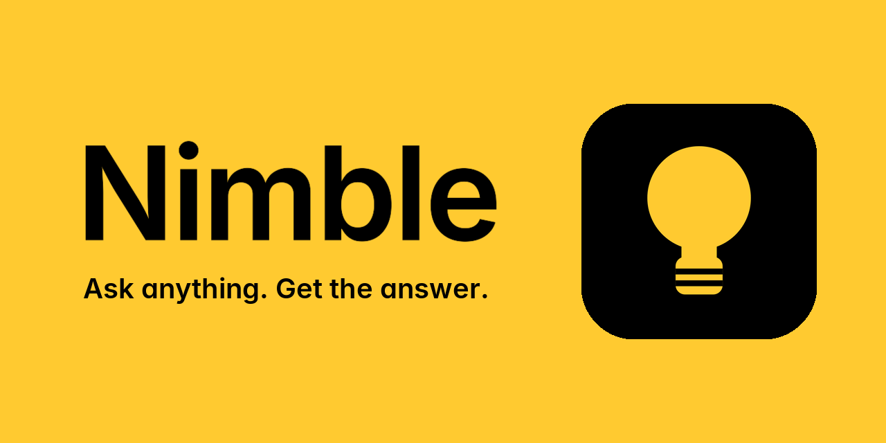
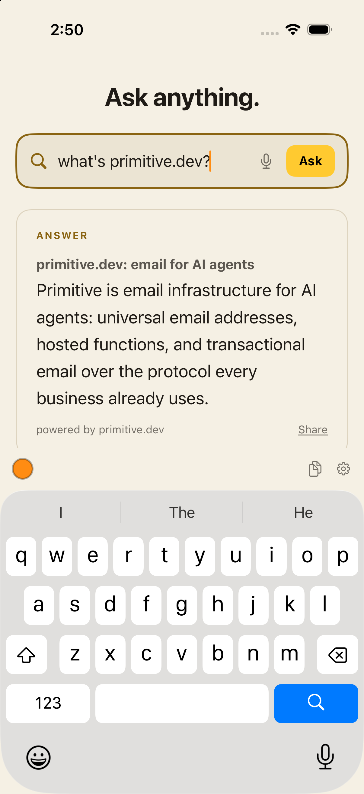
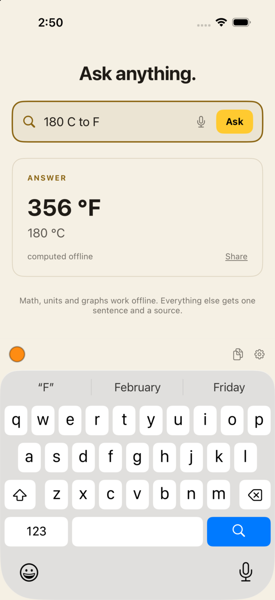
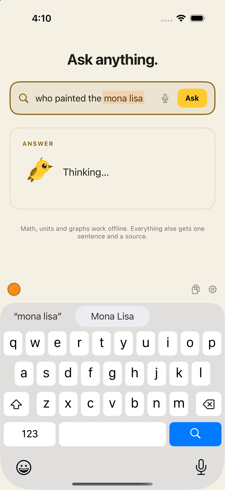
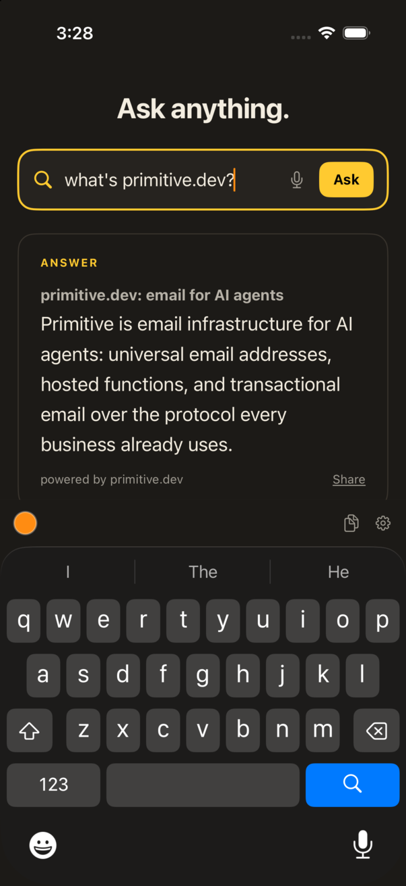
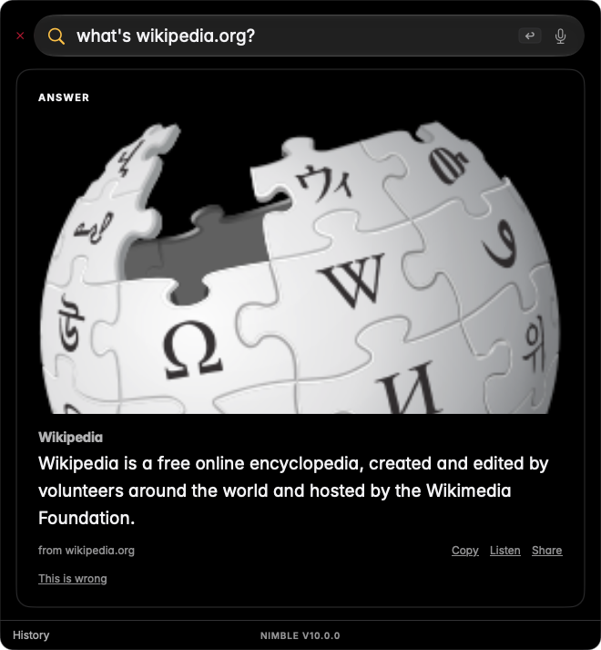
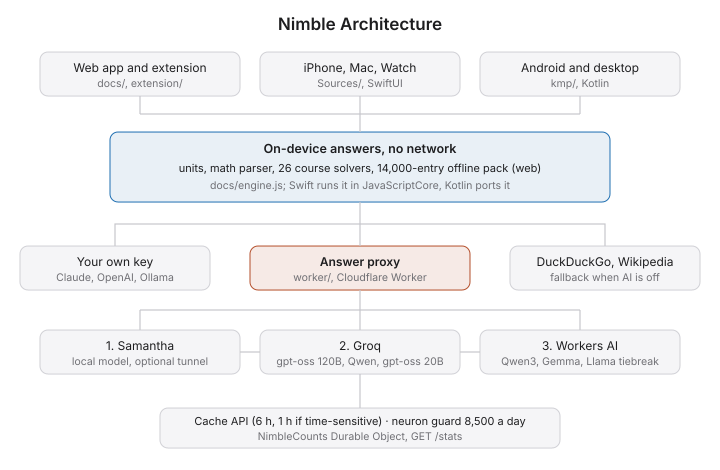

<p align="center"></p>

<p align="center"></p>

# Nimble

 [](https://github.com/nulljosh/nimble/actions/workflows/test.yml) [](https://github.com/nulljosh/nimble/actions/workflows/exam.yml)  [](https://github.com/nulljosh/nimble)

Ask a question. Get one sentence back.

Math, units and graphs answer on the device. Everything else goes to an open model, with a second one when a date, a number or a fresh fact needs checking. DuckDuckGo and Wikipedia catch what the models miss. No API keys, no accounts, no telemetry.

**[nimble.jaybulb.com →](https://nimble.jaybulb.com)** · **[Open the web app →](https://nimble.jaybulb.com/app)**

<p>




</p>


## Get it

[Watch the 23 second promo](docs/promo/nimble-promo.mp4). In a terminal: `brew install nulljosh/nimble/nimble`, then `nimble "question"`.

| | |
|---|---|
| iPhone and Mac | [App Store](https://apps.apple.com/app/nimble-answers/id6807858746) |
| Mac, direct | [Latest release](https://github.com/nulljosh/nimble/releases/latest), signed and notarized. ⌥Space summons it |
| Windows, Android | `.msi` and `.apk` on the same release |
| Web | [nimble.jaybulb.com/app](https://nimble.jaybulb.com/app), works offline once loaded |
| Terminal | `swift build && ./.build/debug/nimble-tui "your question"` |

## How it answers

1. Units, math and graphs: evaluated on the device. `5 miles to km`, `15% of 240`, `plot sin(x)`.
2. Dictionary, weather, local time and currency: pattern-gated live sources.
3. Everything else: `worker/worker.js` asks Groq's free models first (gpt-oss 120B, then Qwen 27B, then gpt-oss 20B) and Cloudflare Workers AI second (Qwen3, then Gemma for time-sensitive, date and number questions). When two models split, a third breaks the tie. If nothing agrees, the app shows "Sources disagree" with both answers and their model names. Known answers are cached for six hours, a daily neuron guard protects the Cloudflare free tier, and `GET /stats` shows both providers' usage. If every model is out, Wikipedia answers.

Agents get the same engine at `https://nimble.jaybulb.com/api/answer?q=5+miles+to+km` and over MCP at `https://nimble.jaybulb.com/mcp`. Tools: answer, convert, math, graph.

Every answer names its source, and time-sensitive answers carry an "as of" line. Light and dark follow the system. 8 accent themes, picked in Settings.

## What else it does

Weather, currency, local time, word origins, markets and the latest game score come back as cards. Recent questions sit under the field on every surface and never leave the device. On iPhone there are three tabs: Ask, History and Settings. History keeps each question with its saved answer, and you can select several to share or delete. Follow-ups work: ask "and in celsius?" and the last three turns come along. Tap the mic and ask out loud. Share any answer as a yellow card. Tap Listen to hear any answer read aloud by the device's own voice, on the web, iPhone, Mac and Android. A home screen widget keeps your last answer on iPhone, and "Ask Nimble" works from Siri, Spotlight, Shortcuts and the Action button; the Mac answers straight from the menu bar. Agents get the same engine over REST at `/api` and MCP at `/mcp`. Five languages: English, French, Spanish, Chinese, Punjabi.

## Offline pack

You can download a small pack of Wikipedia article intros once: the top 9,000 English articles, about 1.9 MB. It works on the web, iPhone, Mac and Android. On the web, tap "Download offline answers" in the menu; on the apps, use the Offline answers row in Settings. After that, when the network is gone, questions about those articles still get an answer, with the article link and the date the pack was built. Nothing downloads on its own. Private mode goes further: on the web (menu), iPhone, Mac and Android (Settings), with it on no question leaves the device, and answers come only from math, units, graphs, this pack and, where Apple Intelligence is ready, the on-device model. Math is offline everywhere; units and graphs are offline on the web, iPhone and Mac. See `docs/pack/README.md` for the format and the license.

## Development

```bash
xcodegen generate && open Nimble.xcodeproj   # macOS + iOS
node --test 'test/*.test.*js'               # web engine
cd worker && npx wrangler deploy             # answer proxy
scripts/release-macos.sh                     # signed, notarized Mac zip
```

The landing page is the web app: `docs/index.html` + `docs/app.html` + `docs/engine.js`, deployed to Cloudflare Pages on push. The app icon is `Nimble.icon`, an Icon Composer bundle.



Open work is in [roadmap.md](roadmap.md). Design notes in the [whitepaper](WHITEPAPER.md).

## License

MIT 2026 Joshua Trommel
