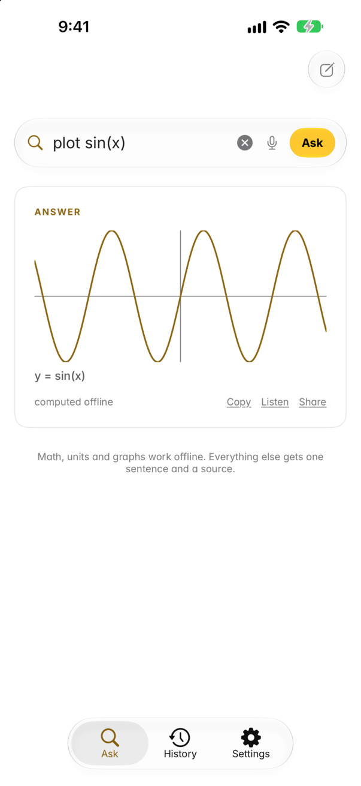

 [](https://github.com/nulljosh/nimble/actions/workflows/test.yml) [](https://github.com/nulljosh/nimble/actions/workflows/exam.yml) 

Ask a question. Get one sentence back.

Math, units and graphs answer on the device. Everything else goes to an open model. A second model checks dates, numbers and fresh facts. DuckDuckGo and Wikipedia catch what the models miss. No API keys, no accounts, no telemetry.

<p>




</p>


## Get it

[Watch the 23 second promo](docs/promo/nimble-promo.mp4). In a terminal, on the Mac or Linux, run `brew install nulljosh/tap/nimble`, then `nimble "question"`.

| | |
|---|---|
| iPhone and Mac | [App Store](https://apps.apple.com/app/nimble-answers/id6807858746) |
| Mac, direct | [Latest release](https://github.com/nulljosh/nimble/releases/latest), signed and notarized. ⌥Space summons it |
| Windows, Android | `.msi` and `.apk` on the same release |
| Web | [nimble.jaybulb.com/app](https://nimble.jaybulb.com/app), works offline once loaded |
| Terminal | `swift build && ./.build/debug/nimble-tui "your question"` |

## How it answers

1. Units, math and graphs: evaluated on the device. `5 miles to km`, `15% of 240`, `plot sin(x)`.
2. Dictionary, weather, local time and currency: pattern-gated live sources.
3. Everything else: `worker/worker.js` asks Groq's free models first (gpt-oss 120B, then Qwen 27B, then gpt-oss 20B). Cloudflare Workers AI is second (Qwen3, then Gemma for time-sensitive, date and number questions).

When two models split, a third breaks the tie. If nothing agrees, the app shows "Sources disagree" with both answers and their model names. If every model is out, Wikipedia answers.

Known answers are cached for six hours. A daily neuron guard protects the Cloudflare free tier. `GET /stats` shows both providers' usage.

Agents get the same engine over REST at `https://nimble.jaybulb.com/api/answer?q=5+miles+to+km` and over MCP at `https://nimble.jaybulb.com/mcp`. Tools: answer, convert, math, graph.

Every answer names its source. Time-sensitive answers carry an "as of" line.

## How good is it

On a 154-question exam, Groq's free models score 154 (answers in 0.94 s at the median, 2.0 s at p95) and the local Samantha model scores 147. A second exam of 1,049 questions runs weekly: math and units are computed and offline (810 of 810), facts are a rotating slice. Method and numbers in [docs/BENCHMARK.md](docs/BENCHMARK.md). The public API, with keys, is in [docs/API.md](docs/API.md).

## Features

Weather, currency, local time, word origins, markets and the latest game score come back as cards.

Recent questions sit under the field on every surface. They never leave the device.

On iPhone there are three tabs: Ask, History and Settings. History keeps each question with its saved answer. Select several to share or delete.

Follow-ups work. Ask "and in celsius?" and the last three turns come along.

Tap the mic and ask out loud. Share any answer as a yellow card. Tap Listen to hear any answer read aloud by the device's own voice, on the web, iPhone, Mac and Android.

A home screen widget keeps your last answer on iPhone. "Ask Nimble" works from Siri, Spotlight, Shortcuts and the Action button. The Mac answers straight from the menu bar. An Apple Watch app and lock screen widgets ship with the iPhone app.

Nine languages: English, French, Spanish, Chinese, Punjabi, German, Portuguese, Hindi, Japanese.

Light and dark follow the system. There are 8 accent themes, picked in Settings.

## Offline pack

You can download a small pack of Wikipedia article intros once. It holds the top 9,000 English articles, about 1.9 MB, and works on the web, iPhone, Mac and Android.

On the web, tap "Download offline answers" in the menu. On the apps, use the Offline answers row in Settings. Nothing downloads on its own.

After that, questions about those articles still get an answer when the network is gone. The answer comes with the article link and the date the pack was built.

Private mode goes further. With it on, no question leaves the device on the web (menu), iPhone, Mac and Android (Settings). Answers come only from math, units, graphs, this pack and, where Apple Intelligence is ready, the on-device model.

Math is offline everywhere. Units and graphs are offline on the web, iPhone and Mac. See `docs/pack/README.md` for the format and the license.

## Development

```bash
xcodegen generate && open Nimble.xcodeproj   # macOS + iOS
node --test 'test/*.test.*js'               # web engine
cd worker && npx wrangler deploy             # answer proxy
scripts/release-macos.sh                     # signed, notarized Mac zip
```

The landing page is the web app: `docs/index.html` + `docs/app.html` + `docs/engine.js`, deployed to Cloudflare Pages on push. The app icon is `Nimble.icon`, an Icon Composer bundle.


Open work is in [roadmap.md](roadmap.md). Design notes in the [whitepaper](WHITEPAPER.md).

## License

Apache 2.0, 2026 Joshua Trommel. See [LICENSE](LICENSE).
